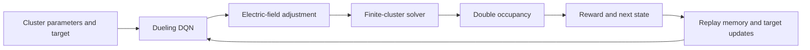

# Deep RL for Autonomous Control of Hubbard Clusters

A notebook-based research implementation that combines finite-cluster Hubbard-model calculations with a **dueling deep Q-network** for controlling double occupancy through an applied electric field.

[](https://github.com/shivanshudwivedi/Deep-RL-for-Autonomous-Control-of-Hubbard-Clusters/actions/workflows/numerical-smoke.yml)

**Explore:** [Notebook map and reproduction](docs/REPRODUCIBILITY.md) · [Figure provenance](docs/FIGURE_PROVENANCE.md) · [Small numerical check](scripts/smoke_solver.py)

## The control problem

An environment samples a cluster geometry, hopping amplitude, interaction strength, temperature, initial electric field and target double occupancy. An agent changes the three field components and receives a reward based on progress toward the target. A finite-particle-sector solver supplies the environment's double-occupancy estimate.

The main implementation is **cell 0 of [ReinforcementModel.ipynb](ReinforcementModel.ipynb)**:

| Component | Implementation detail |
|---|---|
| State | 8 values: geometry, physical parameters, field components and target occupancy |
| Actions | 27 discrete field adjustments |
| Episode | Up to 30 steps; environment termination also checks target error |
| Q-network | Geometry embedding, shared encoder and separate value/advantage heads |
| Training | Experience replay, target network and epsilon-greedy exploration |
| Example run | 2,000 training episodes followed by 200 evaluation episodes in the cell's main block |
| Saved artifact | `models/quantum_control_dqn.pth`, created when training is executed |

These numbers describe code configuration. They are not measured accuracy, sample-efficiency or runtime results.



## Start with a small check

Python 3.11 is the CI environment. This path needs only NumPy and SciPy; it does not install PyTorch or start training.

```bash
python3.11 -m venv .venv
source .venv/bin/activate
python -m pip install -r requirements-smoke.txt
python scripts/smoke_solver.py
```

The script extracts the original solver definitions without executing notebook main blocks. It checks the 70-state half-filled tetrahedron's particle count, matrix Hermiticity, eigenpair residuals, finite bounded occupancy at three temperatures, and the zero-hopping ground-state limit. The [retained local output](docs/numerical-smoke.json) is numerical sanity evidence only.

For RL training and interactive simulations, follow the [notebook guide](docs/REPRODUCIBILITY.md). Do not run every cell indiscriminately: the notebooks contain independent program versions, interactive prompts and long-running experiments.

## Repository map

| Artifact | Purpose |
|---|---|
| [`ReinforcementModel.ipynb`](ReinforcementModel.ipynb) | Solver/environment/DQN in cell 0; illustrative plotting programs in cells 1–2 |
| [`3-D-Hubbard-Model.ipynb`](3-D-Hubbard-Model.ipynb) | Multiple exploratory solver, thermal, geometry and mean-field programs |
| [`Eigen_multi_orbital.ipynb`](Eigen_multi_orbital.ipynb) | Bitwise Hamiltonian construction, eigenstates and occupation analysis |
| `plots1/`, `plots2/`, `1.png`–`3.png` | Committed figures; see provenance before interpreting |
| [`scripts/smoke_solver.py`](scripts/smoke_solver.py) | Lightweight numerical verification against the notebook's solver definitions |

## Research evidence and limitations

The related publication is linked by [DOI 10.1063/5.0310012](https://doi.org/10.1063/5.0310012). Publication claims should be evaluated from the paper and its experiment records.

**Some plotting cells generate simulated comparison data.** Their figures are illustrations, not retained measurements from a trained agent. This repository does not currently provide a complete immutable run manifest, trained checkpoint, raw evaluation traces or multi-seed aggregate report linking every committed figure to measured experiments. See [figure provenance](docs/FIGURE_PROVENANCE.md).

The numerical smoke check does not certify the physics. In particular, the RL notebook's hopping construction needs an independent fermionic-parity/sign convention review before interpreting quantitative results as a validated Hubbard simulation. Dense diagonalization limits cluster size; a notebook implementation is not a scalable many-body solver or laboratory control system.

A useful next research contribution is a validated Hamiltonian reference comparison, followed by seeded training/evaluation artifacts and figure generation directly from those records. Keep illustrative figures and measured results clearly separated.
